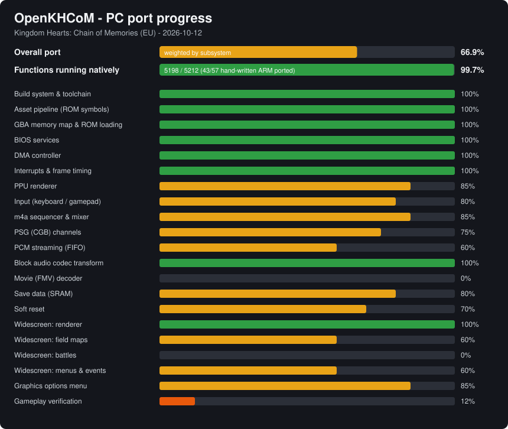

# ReKHCoM progress

**Overall: 91.3%** - generated by `python port/tools/progress.py` on 2026-10-13.

## Functions

Counts follow the inherited function map, including movie table and codec boundary labels.
Native coverage measures implemented replacements, not gameplay verification.

| | Count |
|---|---:|
| Functions in the EU ROM | 5212 |
| Decompiled C, compiled natively | 5155 |
| Hand-written ARM in the ROM | 57 |
| ...ported to C for the PC build | 57 |
| **Running natively** | **5212 (100.00%)** |
| Game C units compiled for x86 | 269 / 269 |

## Subsystems

| Subsystem | Weight | Done | Notes |
|---|---:|---:|---|
| Build system & toolchain | 4 | 100% | clang i686 + SDL3, ninja, one command |
| Asset pipeline (ROM symbols) | 4 | 100% | 61k symbols pinned to the ROM, 47 native relocations |
| GBA memory map & ROM loading | 4 | 100% | address space embedded in the PE image; NULL and out-of-range accesses emulate the GBA bus (port_biosfault.c) |
| BIOS services | 3 | 100% | CpuSet, CpuFastSet, LZ77, BgAffineSet, Sqrt, reset |
| DMA controller | 3 | 100% | immediate, VBlank, HBlank with register latching |
| Interrupts & frame timing | 4 | 100% | exact 59.7275 Hz pacing, one game update per VBlank (verified against BizHawk); FPS and logic-rate readout |
| PPU renderer | 10 | 92% | modes 0-5, affine, windows, blending, mosaic, OBJ window; HUD layer follows GBA priorities (message windows stay in front) |
| Input (keyboard / gamepad) | 3 | 100% | remappable keyboard (two keys per action) and gamepad buttons in kh_com.ini and the launcher; one-button dodge roll and stock (L+R); right stick changes and stocks cards |
| m4a sequencer & mixer | 8 | 90% | full C port of m4a_1.s, 4x oversampled mixing; song loops checked against the ROM's sequence data |
| PSG (CGB) channels | 3 | 90% | square+sweep (band-limited), wave, noise, envelopes, length, NR50-52 routing; 79 songs/effects use CGB voices (KHCOM_SONG plays one); one wave RAM bank, as m4a's bank switching within a frame produces the same result; hardware recording comparison pending |
| PCM streaming (FIFO) | 2 | 95% | FIFO A/B fed by the DMA aimed at them, each at its own timer's rate; movie audio identical before/after, rate exact; hardware recording comparison pending |
| Block audio codec transform | 1 | 100% | transform.s in C |
| Movie (FMV) decoder | 6 | 100% | native C; all 3605 video frames and 3604 audio blocks match ARM; all five movies play to their last frame and hand over to the next scene (castle, Larxene, Destiny Islands, staff roll) — KHCOM_MOVIE |
| Save data (SRAM) | 3 | 100% | kh_com.sav (per version) next to the exe, atomic writes; quick save, restart and load verified |
| Soft reset | 1 | 100% | A+B+Select+Start returns to the language select; game globals restored from a snapshot |
| Widescreen: renderer | 5 | 100% | world-map extension for map-block BGs, full-range sprite positions, per-scene validation |
| Widescreen: field maps | 8 | 85% | map-block rooms and cell-built rooms extend with the game's own composition; void beyond the world is black |
| Widescreen: battles | 6 | 92% | affine arenas extend and repeat sideways; HUD on its own scaled layer anchored to the corners, card hand lifted to show whole cards; tutorial pointers follow the HUD; battle messages docked |
| Widescreen: menus & events | 4 | 93% | Pause/save/world selection/level up use a screen layer. Deck, status and map-card margins now extend backgrounds without foreground sprites; world map repeats ornamental patterns. Level-up sprite, cyan door flash, submenu exit animation and stress crash remain open. |
| Graphics options menu | 5 | 92% | overlay with the game font, 5 languages, live changes; HUD size, HD text, control options; opened from title (SELECT), F1/Esc, Back+Start |
| Gameplay verification | 10 | 66% | Earlier EU/US/JP reports: 194 event and 209 debug battle smoke cases per region; bounded runs, not full playthroughs. Twelve traced START/deck/field cycles passed. Add-card crash reproduced through normal navigation and fixed by initializing caption counts; Add/Remove/field regression passed. Other repeated submenu crashes remain under investigation. |
| Save states | 2 | 90% | F5/F9, slots F6/F7; SRAM excluded; validated per build |
| HD text | 3 | 88% | KHMenu Latin/menu text, Japanese glyphs and Comic Hearts subtitles. Fresh EU/JP opening captures verified after Shift-JIS fix. Map-card tutorial caption hidden while its notice is open; general occlusion regression, stylized art and remaining digits still pending. |
| USA and Japanese versions | 6 | 80% | Separate native builds and per-region saves. Earlier US and JP reports completed 194 event and 209 battle smoke cases. Latest sources compile for all three regions; fresh visual and gameplay regressions remain. |
| Launcher & ROM install | 4 | 92% | decompui (Dear ImGui): installs any of the three dumps by SHA-1, settings, enhancements, editable controls, game language (EU), save card (date, open folder, back up), launcher language, version; starts the matching game |
| Skip intro | 1 | 100% | A shows a prompt in the game's font with an A button; A again skips the opening |

## Milestones

- [x] All 269 game units compile for x86
- [x] Executable links
- [x] Boots to language select
- [x] Title screen
- [x] New game / first room
- [x] First card battle
- [x] Widescreen field
- [x] Graphics options menu in game
- [x] Opening movie plays
- [x] Game speed verified against hardware
- [x] HD text
- [ ] Launcher with ROM install
- [ ] USA and Japanese versions
- [ ] Full playthrough (Sora)
- [ ] Full playthrough (Reverse/Rebirth)
